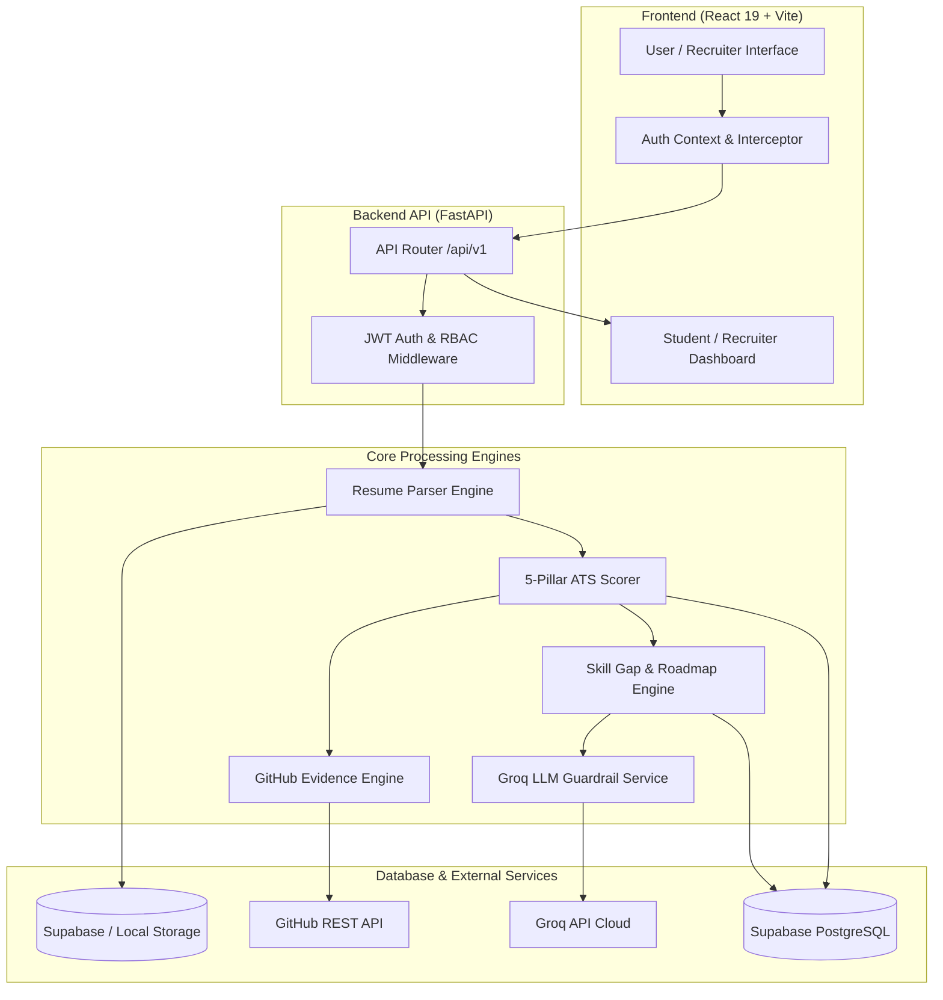

# 🚀 SkillGap AI & ATS Resume Analyzer — Comprehensive Project Documentation

Welcome to the official technical documentation for **SkillGap AI & ATS Resume Analyzer**. This document provides an exhaustive overview of the platform architecture, technology stack, database schemas, scoring algorithms, business logic, API specifications, and deployment procedures.

---

## 📋 Table of Contents
1. [Executive Summary & Platform Overview](#-executive-summary--platform-overview)
2. [Core Platform Pillars](#-core-platform-pillars)
3. [Technology Stack](#-technology-stack)
4. [System Architecture & Data Flow](#-system-architecture--data-flow)
5. [Database Schema (Supabase PostgreSQL)](#-database-schema-supabase-postgresql)
6. [Core Services & Business Logic](#-core-services--business-logic)
   - [1. Resume Parsing & Extraction Dispatcher](#1-resume-parsing--extraction-dispatcher)
   - [2. Deterministic 5-Pillar ATS Scoring Engine](#2-deterministic-5-pillar-ats-scoring-engine)
   - [3. Automated GitHub Evidence Cross-Validation](#3-automated-github-evidence-cross-validation)
   - [4. Single-Source Skill Gap & Roadmap Engine](#4-single-source-skill-gap--roadmap-engine)
   - [5. LLM Integration & Fallback Guardrails](#5-llm-integration--fallback-guardrails)
7. [Frontend Application Architecture](#-frontend-application-architecture)
   - [Student Acceleration Portal](#student-acceleration-portal)
   - [Recruiter Intelligence Console](#recruiter-intelligence-console)
   - [Admin Control Center](#admin-control-center)
8. [API Specification & Endpoints Map](#-api-specification--endpoints-map)
9. [DevOps, Docker & Cloud Deployment](#-devops-docker--cloud-deployment)
10. [Local Development & Setup Guide](#-local-development--setup-guide)

---

## 🌟 Executive Summary & Platform Overview

**SkillGap AI & ATS Resume Analyzer** is an enterprise-grade, unified AI-powered recruitment and career acceleration platform. The system bridges the gap between job seekers (students/professionals) and technical recruiters by delivering:

1. **Zero-Hallucination ATS Scoring**: A 100% mathematical, deterministic 5-pillar scoring algorithm that evaluates resumes objectively without relying on LLM guesswork.
2. **Automated GitHub Cross-Validation**: Deep-code inspection that cross-checks resume claims against real-world GitHub repositories, commit frequency, dependency trees, and project authenticity.
3. **Single-Source Skill Gap Engine**: Instant benchmarking of student skills against top-tier tech roles or custom Job Descriptions (JDs), generating personalized 4-week learning roadmaps.
4. **Two-Sided Platform Interface**:
   - **Student Acceleration Portal**: Resume diagnostic tools, score card visualization, LeetCode/DSA tracker by company, psychometric career tests, live industry tech news, and job application tracker.
   - **Recruiter Intelligence Console**: Automated applicant pipeline sorting, candidate evaluation drawers, minimum ATS threshold filtering, and on-demand AI candidate summary & interview question generation.

---

## 🏗️ Core Platform Pillars

### 1. Deterministic 5-Pillar ATS Scoring Engine (Zero Hallucination)
Traditional AI resume screeners often hallucinate scores. SkillGap AI decouples scoring from LLMs, using strict mathematical formulas across 5 fundamental pillars (total 100 points):

- **Formatting & Structure (20 Points)**: Evaluates bullet counts, section completeness, professional summary presence, and structured layout.
- **Keyword & Technical Taxonomy (25 Points)**: Normalized ESCO taxonomy matching using RapidFuzz string distance against standardized skill databases.
- **Content Quality & Action Verbs (25 Points)**: Analyzes strong power action verbs (12 pts) and regex-detected quantifiable metrics (e.g., `%`, `$`, throughput numbers) (13 pts).
- **Skill Validation via Embeddings (15 Points)**: Uses SentenceTransformers (`all-MiniLM-L6-v2`) cosine-similarity vector embeddings to verify claimed skills against project descriptions and work history.
- **ATS System Parseability (15 Points)**: Detects PII privacy risks (full street addresses / zip codes) and screens for non-standard box-drawing or table characters that break legacy ATS parsers.

### 2. Deep GitHub Code Evidence Analysis
Protects recruiters against inflated resumes by verifying claims through the GitHub API:
- Extracts repositories, commit histories, `package.json`, `requirements.txt`, `Dockerfile`, and Readme files.
- Verifies code maturity, developer activity frequency, project authenticity, and generates an **Enhanced ATS Score**.

### 3. Single-Source Skill Gap & 4-Week Learning Roadmap
- Resume files are uploaded and parsed once.
- The pre-parsed structure is benchmarked against target companies (FAANG, Tier-1 tech, startups) or custom JDs.
- Computes skill gap percentages and outputs an actionable **4-Week Learning Roadmap** with free curated learning resources (FreeCodeCamp, Official Documentation, Coursera, YouTube).

### 4. Recruiter Candidate Intelligence
- Deterministic sorting of applicants by **ATS Score** or **Match %**.
- One-click status updates (`applied` -> `reviewing` -> `shortlisted` -> `rejected` -> `offered`).
- AI candidate summary generation and tailored technical interview questions based on candidate weaknesses.

---

## 🛠️ Technology Stack

| Layer | Technologies & Libraries |
|---|---|
| **Backend Framework** | Python 3.12, FastAPI, Uvicorn (ASGI Server) |
| **Database & Storage** | Supabase (PostgreSQL with `pgcrypto` & `uuid-ossp`), Supabase Storage (`resumes` bucket), Local File Storage |
| **Artificial Intelligence & Machine Learning** | Groq API (`groq`), SentenceTransformers (`all-MiniLM-L6-v2`), PyTorch (`torch`), spaCy (`en_core_web_sm`), RapidFuzz |
| **Parsing & Document Processing** | `pdfplumber`, `PyPDF2`, `python-docx`, Python `io`, Regex |
| **Authentication & Security** | `PyJWT` (Access & Refresh JWTs), `bcrypt` (Salted Password Hashing), Pydantic v2 Settings |
| **PDF Generation** | `xhtml2pdf`, `reportlab`, `jinja2` |
| **Frontend Framework & Build Tool** | React 19, Vite 6, React Router DOM 7 |
| **Styling & Design System** | Tailwind CSS v3, PostCSS, Autoprefixer, `clsx`, `tailwind-merge`, `class-variance-authority` |
| **UI Components & Icons** | Radix UI primitives, Framer Motion 12 (Animations), Lucide React (Iconography), Sonner (Toasts) |
| **Data Visualization & Themes** | Recharts 3 (Radar, Bar, Pie charts), `next-themes` (Dark/Light mode) |
| **HTTP Interceptor** | Axios (with automatic JWT token refresh & retry interceptor) |
| **DevOps & Containerization** | Docker, Docker Compose, Hugging Face Spaces (Docker Engine), Render, Vercel |

---

## 📐 System Architecture & Data Flow



---

## 🗄️ Database Schema (Supabase PostgreSQL)

The database operates on Supabase PostgreSQL with `UUID` primary keys, foreign key constraints, index optimizations, and Row-Level Security (RLS) policies.

```
                    ┌─────────────────────────┐
                    │      public.users       │
                    └────────────┬────────────┘
                                 │ 1
                                 │
                 ┌───────────────┼───────────────┐
                 │ N             │ N             │ N
        ┌────────┴──────┐ ┌──────┴──────┐ ┌──────┴──────────────┐
        │ public.resumes│ │public.jobs  │ │public.skill_gap_... │
        └───────┬───────┘ └──────┬──────┘ └─────────────────────┘
                │ 1              │ 1
                │                │
        ┌───────┴────────┐       │
        │public.ats_...  │       │
        └───────┬────────┘       │
                │ 1              │
                │                │
                └────────┬───────┘
                         │ N
              ┌──────────┴──────────┐
              │ public.applications │
              └─────────────────────┘
```

### Table Definitions & Key Fields

#### 1. `public.users`
Stores student, recruiter, and administrator user accounts.
- `id` (UUID, Primary Key)
- `email` (TEXT, Unique)
- `password_hash` (TEXT)
- `full_name` (TEXT)
- `role` (TEXT: `student` | `recruiter` | `admin`)
- `company_name`, `headline`, `github_url`, `linkedin_url` (TEXT)

#### 2. `public.resumes`
Stores raw extracted text and structured JSON parsing metadata.
- `id` (UUID, Primary Key)
- `user_id` (UUID, Foreign Key -> `users.id`)
- `filename`, `file_url`, `file_type` (TEXT)
- `raw_text` (TEXT)
- `parsed_data` (JSONB)
- `extracted_skills`, `action_verbs`, `keywords` (JSONB)

#### 3. `public.ats_reports`
Holds 5-pillar mathematical score breakdowns and diagnostic feedback.
- `id` (UUID, Primary Key)
- `user_id` (UUID, Foreign Key)
- `resume_id` (UUID, Foreign Key)
- `overall_score`, `formatting_score`, `keywords_score`, `content_score`, `skill_validation_score`, `ats_compatibility_score` (NUMERIC)
- `strengths`, `critical_issues`, `suggestions`, `recommendations` (JSONB)
- `skill_validation_details`, `penalties`, `bonuses`, `github_evidence` (JSONB)

#### 4. `public.github_evidence`
Tracks deep code inspection cross-validation metrics.
- `id` (UUID, Primary Key)
- `user_id`, `resume_id`, `ats_report_id` (UUID, Foreign Keys)
- `github_username` (TEXT)
- `github_evidence_score`, `enhanced_ats_score` (NUMERIC)
- `repositories_analyzed`, `projects_verified_count`, `skills_verified_count` (INT)
- `project_matches`, `skill_matches`, `authenticity_analysis` (JSONB)

#### 5. `public.companies` & `public.jobs`
Recruiter job posting management schema.
- `companies`: `id`, `name`, `slug`, `recruiter_id`, `logo_url`, `location`
- `jobs`: `id`, `title`, `company_id`, `recruiter_id`, `location`, `job_type`, `experience_level`, `required_skills`, `min_ats_score`, `is_active`

#### 6. `public.applications`
Connects candidate resumes and ATS reports directly to recruiter job openings.
- `id` (UUID, Primary Key)
- `job_id`, `student_id`, `resume_id`, `ats_report_id` (UUID, Foreign Keys)
- `ats_score`, `match_percentage` (NUMERIC)
- `status` (TEXT: `applied` | `reviewing` | `shortlisted` | `rejected` | `offered`)
- `ai_candidate_summary` (TEXT)
- `ai_interview_questions` (JSONB)

#### 7. `public.skill_gap_reports` & `public.career_test_results`
- `skill_gap_reports`: Target company, target role, match %, missing skills, 4-week roadmap text, curated learning resources JSONB, company DSA problems.
- `career_test_results`: User psychometric assessment responses, matched engineering career path, explanation, and strengths.

---

## 🧠 Core Services & Business Logic

### 1. Resume Parsing & Extraction Dispatcher
Located in `backend/app/services/resume_parser.py`:
- **Validation**: Enforces 10MB maximum file size and checks file extensions (`.pdf`, `.docx`, `.doc`, `.txt`, `.md`).
- **PDF Extraction**: Executes `pdfplumber` for layout-aware text extraction. If page text is empty or sparse, automatically falls back to `PyPDF2`. Extracts embedded PDF hyperlinks (LinkedIn, GitHub, Portfolios).
- **Word Extraction**: Uses `python-docx` to extract text from both standard paragraphs and multi-column tabular data, retaining target hyperlinks.

### 2. Deterministic 5-Pillar ATS Scoring Engine
Located in `backend/app/services/ats_scorer.py`:
- **Zero-LLM Scoring**: Computes score components using deterministic rules:
  $$\text{Base Score} = S_{\text{formatting}} (20) + S_{\text{keywords}} (25) + S_{\text{content}} (25) + S_{\text{validation}} (15) + S_{\text{ats\_compat}} (15)$$
- **Skill Embedding Validation**: Computes cosine similarity between claimed skills and project/experience text:
  $$\text{Cosine Sim}(u, v) = \frac{u \cdot v}{\|u\| \|v\|}$$
  If vector similarity exceeds threshold ($\ge 0.55$) or keyword variants match, the skill is tagged as **Validated**.
- **Adjustments**: Applies bonuses ($+$ verified skills evidence, genuine experience match, publications/certifications) and penalties ($-$ unverified skills, high missing JD keywords, location PII risk).

### 3. Automated GitHub Evidence Cross-Validation
Located in `backend/app/services/evidence_engine.py` & `github_service.py`:
- Fetches candidate's top 15 public GitHub repositories.
- Scans `package.json`, `requirements.txt`, `pyproject.toml`, and `Dockerfile` to verify real technical usage.
- Evaluates commit frequency, repository maturity, original vs. forked code ratios, and calculates an **Enhanced ATS Score**.

### 4. Single-Source Skill Gap & Roadmap Engine
Located in `backend/app/services/skill_gap_engine.py`:
- Consumes pre-parsed resume structure to eliminate redundant processing.
- Compares candidate skills against target role skill taxonomies.
- Generates a **4-Week Learning Roadmap** categorized by week, featuring direct links to free curated learning resources (FreeCodeCamp, Docs, YouTube).

### 5. LLM Integration & Fallback Guardrails
Located in `backend/app/services/groq_service.py`:
- **Model Hierarchy**: Uses Groq API with automatic fallback options (`llama-3.3-70b-versatile`, `qwen/qwen3.6-27b`, etc.).
- **Strict Isolation**: LLMs are **never** permitted to generate numerical ATS scores. They are strictly restricted to JSON entity extraction, personalized feedback advice, learning roadmaps, candidate executive summaries, and custom technical interview questions.
- **Rule-Based Fallbacks**: If the Groq API key is missing or offline, built-in regex section parsers and deterministic fallback engines take over seamlessly.

---

## 🎨 Frontend Application Architecture

Built with **React 19**, **Vite**, and **Tailwind CSS**, styled for dark/light themes using Framer Motion micro-animations.

```
frontend/src/
├── components/
│   ├── common/             # Navbar, Footer, LoadingSpinners
│   ├── github/             # GitHub Evidence Card & Repository Drawer
│   └── ui/                 # Buttons, Cards, Inputs, Dialogs, Accordions (Radix UI)
├── context/
│   ├── AuthContext.jsx     # User Authentication & Role-Based State
│   └── ThemeContext.jsx    # Dark / Light Mode state switcher
├── lib/
│   └── axios.js            # Axios client with auto-refresh JWT intercepter
├── pages/
│   ├── LandingPage.jsx     # Platform Hero & Features overview
│   ├── AuthPage.jsx        # Login & Registration with Role selection
│   ├── Dashboard.jsx       # Student Career Acceleration Dashboard
│   ├── UploadResume.jsx    # Interactive Resume Upload & 5-Pillar Score Cards
│   ├── SkillAnalysis.jsx   # Single-Source Skill Gap & 4-Week Roadmap
│   ├── JobListings.jsx     # Verified Job Board & Application submission
│   ├── DSATracker.jsx      # Company-wise LeetCode/DSA problem tracker
│   ├── CareerTest.jsx      # 10-Question Psychometric Career Test
│   ├── JobNews.jsx         # Live Tech Hiring News feed
│   ├── ProfilePage.jsx     # User Profile & Security Settings
│   ├── recruiter/          # Recruiter Console (Dashboard, Jobs Management, Candidate Search)
│   └── admin/              # System Health & Platform Analytics Dashboard
└── App.jsx                 # React Router DOM v7 configuration & protected routes
```

### Student Acceleration Portal
- **Score Card Visualization**: Displays overall score gauge, radar charts of the 5 pillars, breakdown of validated vs. unvalidated skills, and downloadable branded PDF reports.
- **Single-Source Skill Analysis**: Enables side-by-side comparison of candidate skills vs. FAANG/target roles.
- **Company DSA Tracker**: Searchable table of curated LeetCode questions tagged by target company and topic.

### Recruiter Intelligence Console
- **Candidate Pipeline Ranking**: Ranked applicant table sorted deterministically by ATS Score or Match %.
- **Candidate Evaluation Drawer**: View applicant 5-pillar scores, GitHub evidence badges, and generate AI Candidate Summaries & targeted Technical Interview Questions on demand.

---

## 🌐 API Specification & Endpoints Map

All API endpoints are mounted under the `/api/v1` prefix.

| Category | Method | Endpoint | Auth Required | Description |
|---|---|---|---|---|
| **Auth** | `POST` | `/api/v1/auth/register` | No | Register new student or recruiter account |
| **Auth** | `POST` | `/api/v1/auth/login` | No | Authenticate user and issue JWT Access/Refresh tokens |
| **Auth** | `GET` | `/api/v1/auth/me` | Yes | Retrieve current authenticated user profile |
| **ATS** | `POST` | `/api/v1/ats/upload-and-analyze` | Yes | Upload resume file & execute 5-pillar ATS scoring |
| **ATS** | `GET` | `/api/v1/ats/reports/{id}` | Yes | Retrieve detailed ATS report by ID |
| **ATS** | `GET` | `/api/v1/ats/reports/{id}/export-pdf` | Yes | Export branded PDF report |
| **Skill Gap** | `POST` | `/api/v1/skill-gap/analyze` | Yes | Single-source skill gap analysis & 4-week roadmap |
| **Skill Gap** | `GET` | `/api/v1/skill-gap/companies` | Yes | Get list of benchmark target companies |
| **GitHub** | `POST` | `/api/v1/github/analyze-evidence` | Yes | Execute deep-code GitHub cross-validation |
| **Jobs** | `GET` | `/api/v1/jobs` | Yes | Browse active job listings with search/filters |
| **Jobs** | `POST` | `/api/v1/jobs/{id}/apply` | Yes (Student) | Submit application with verified ATS score |
| **Recruiter** | `GET` | `/api/v1/recruiter/dashboard` | Yes (Recruiter) | Comprehensive recruiter intelligence metrics, KPI distribution & application trends |
| **Recruiter** | `GET` | `/api/v1/recruiter/stats` | Yes (Recruiter) | Aggregate recruiter dashboard statistics & job-wise analytics |
| **Recruiter** | `POST` | `/api/v1/recruiter/jobs` | Yes (Recruiter) | Create job opening with minimum ATS score threshold |
| **Recruiter** | `GET` | `/api/v1/recruiter/jobs/{id}/candidates` | Yes (Recruiter) | Candidate pipeline sorted by ATS, JD match, GitHub evidence, or date |
| **Recruiter** | `GET` | `/api/v1/recruiter/applications/{id}` | Yes (Recruiter) | Detailed candidate evaluation dossier (Sections A, B, C, D, E) |
| **Recruiter** | `GET` | `/api/v1/recruiter/applications/{id}/resume` | Yes (Recruiter) | Authorized secure resume document streaming / preview |
| **Recruiter** | `GET` | `/api/v1/recruiter/applications/{id}/audit-logs` | Yes (Recruiter) | Audit trail of hiring pipeline status decisions |
| **Recruiter** | `POST` | `/api/v1/recruiter/applications/{id}/ai-summary` | Yes (Recruiter) | Groq AI candidate intelligence summary & tailored interview questions |
| **Recruiter** | `POST` | `/api/v1/recruiter/applications/{id}/ai-questions` | Yes (Recruiter) | Generate role-specific technical interview questions |
| **Recruiter** | `PATCH` | `/api/v1/recruiter/applications/{id}/status` | Yes (Recruiter) | Update candidate hiring pipeline status with audit logging |
| **Recruiter** | `POST` | `/api/v1/recruiter/jobs/{id}/compare` | Yes (Recruiter) | Side-by-side comparison matrix for 2-5 candidates |
| **Career** | `GET` | `/api/v1/career/test/questions` | Yes | Get psychometric career test questions |
| **Career** | `POST` | `/api/v1/career/test/submit` | Yes | Evaluate test answers & predict career path |
| **Career** | `GET` | `/api/v1/career/dsa/all` | Yes | Fetch LeetCode/DSA problem tracker data |
| **Career** | `GET` | `/api/v1/career/news` | Yes | Fetch live industry tech hiring news |
| **Admin** | `GET` | `/api/v1/admin/dashboard` | Yes (Admin) | System analytics, user statistics, platform health |

---

## 🐳 DevOps, Docker & Cloud Deployment

### Docker Containerization
The platform is fully containerized using multi-stage builds.

`docker-compose.yml`:
```yaml
version: '3.8'

services:
  backend:
    build:
      context: ./backend
      dockerfile: Dockerfile
    ports:
      - "8000:8000"
    environment:
      - SUPABASE_URL=${SUPABASE_URL}
      - SUPABASE_KEY=${SUPABASE_KEY}
      - GROQ_API_KEY=${GROQ_API_KEY}
      - JWT_SECRET_KEY=${JWT_SECRET_KEY}
    restart: always

  frontend:
    build:
      context: ./frontend
      dockerfile: Dockerfile
    ports:
      - "3000:3000"
    environment:
      - VITE_BACKEND_URL=http://localhost:8000
    depends_on:
      - backend
    restart: always
```

### Cloud Deployment Strategy
1. **Backend on Hugging Face Spaces (Recommended for ML/PyTorch)**:
   - SDK: **Docker**
   - Free 16GB RAM + 2 vCPU environment.
2. **Backend on Render (Alternative)**:
   - Configured via `render.yaml` blueprint.
3. **Frontend on Vercel**:
   - Framework preset: **Vite**
   - Environment variable: `VITE_BACKEND_URL` pointing to backend API URL.

---

## ⚡ Local Development & Setup Guide

### Prerequisites
- **Python 3.12+**
- **Node.js 18+** & **npm** / **yarn**
- **Supabase Account** (Free tier at [supabase.com](https://supabase.com))
- **Groq API Key** (Optional, free tier at [console.groq.com](https://console.groq.com))

### 1. Database Setup
1. Create a Supabase project.
2. Navigate to **SQL Editor** -> **New Query**, paste the contents of `backend/supabase_schema.sql`, and execute.
3. Copy the Project URL and `anon` / `service_role` key.

### 2. Environment Variables Configuration

Create `backend/.env`:
```env
PROJECT_NAME="SkillGap AI"
VERSION="3.0.0"
ENVIRONMENT="development"

# Supabase Credentials
SUPABASE_URL="https://your-project.supabase.co"
SUPABASE_KEY="your-supabase-anon-key"

# Groq API Key
GROQ_API_KEY="gsk_your_groq_api_key"

# Optional External Data APIs
GNEWS_API_KEY="your_gnews_api_key"
YOUTUBE_API_KEY="your_youtube_api_key"

# JWT Authentication
JWT_SECRET_KEY="your-super-secret-jwt-key"
ACCESS_TOKEN_EXPIRE_MINUTES=60
REFRESH_TOKEN_EXPIRE_DAYS=7

# CORS Settings
BACKEND_CORS_ORIGINS=["http://localhost:3000", "http://127.0.0.1:3000"]
```

Create `frontend/.env`:
```env
VITE_BACKEND_URL="http://localhost:8000"
```

### 3. Database Migrations (Supabase PostgreSQL)

Apply the versioned SQL migrations in order located in `backend/migrations/`:
1. `backend/migrations/001_initial_schema.sql`: Core tables, indexes, and base foreign keys.
2. `backend/migrations/002_evidence_and_applications.sql`: GitHub evidence tables, application audit logs, and unique constraints.
3. `backend/migrations/003_phase6_final_unified_schema.sql`: Progress persistence (`user_roadmap_progress`, `user_dsa_progress`), cross-module references, and Row Level Security.

### 4. Run Application

#### Option A: Single Command Startup
```bash
npm run dev
```

#### Option B: Manual Execution
```bash
# Terminal 1: Backend
./run_backend.sh

# Terminal 2: Frontend
./run_frontend.sh
```

- **Frontend App**: `http://localhost:3000`
- **Backend API**: `http://localhost:8000`
- **Swagger API Docs**: `http://localhost:8000/docs`

#### Option C: Running the Full Automated Test Suite
```bash
.venv/bin/pytest backend/tests -v
```

---

## 🏆 Phase 6 Deliverables Summary

- **Redesigned Student Dashboard**: Centralized 4-module hub (Career Readiness, Jobs, DSA Tracker, Hiring Intelligence) with Recharts visualizations, 5-pillar ATS breakdown, and progress tracking.
- **Enterprise-Grade Role-Based Navigation**: Distinct student, recruiter, and admin portals with route guards and mobile-responsive drawer.
- **Unified Cross-Module Integration**: Seamless data propagation between ATS scans, skill gaps, learning roadmaps, company DSA problems, job applications, and recruiter candidate dossiers.
- **End-to-End Test Suite**: 54 comprehensive unit and integration tests passing across all real-world scenarios.

---

*Documentation compiled and maintained for SkillGap AI & ATS Resume Analyzer.*
